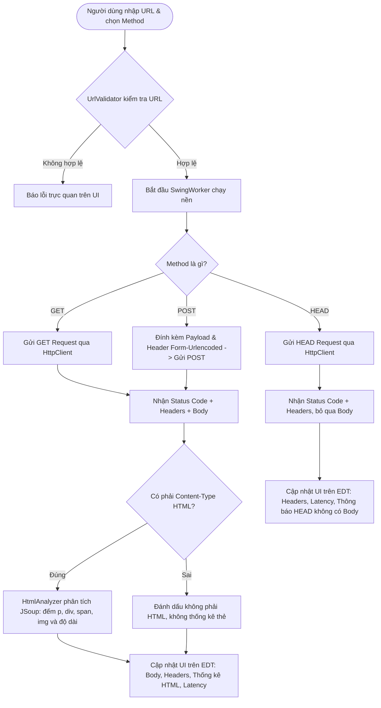

# SIMPLE WEB BROWSER – NHÓM 1
**Môn học: Lập trình Java / Lập trình mạng**  
**Ứng dụng Desktop Browser đơn giản bằng Java Swing, HttpClient và JSoup**

---

## 1. Giới thiệu bài tập và mục tiêu

Dự án **Simple Web Browser** được xây dựng nhằm mô phỏng các hoạt động cốt lõi của một trình duyệt web ở tầng giao thức HTTP:
- Cho phép người dùng nhập địa chỉ URL của tài nguyên web.
- Hỗ trợ lựa chọn một trong 3 phương thức HTTP cơ bản: `GET`, `POST`, `HEAD`.
- Hỗ trợ nhập và gửi payload dữ liệu khi dùng phương thức `POST`.
- Gửi HTTP Request đến máy chủ mục tiêu và nhận kết quả phản hồi gồm: Mã trạng thái (HTTP Status Code), HTTP Response Headers, Response Body và Thời gian thực thi (Latency).
- Tự động phân tích cú pháp HTML (đối với GET/POST có nội dung HTML) bằng thư viện **JSoup** và thống kê:
  - Chiều dài nội dung HTML trả về (tính theo số ký tự).
  - Số lượng thẻ `<p>`.
  - Số lượng thẻ `<div>`.
  - Số lượng thẻ `<span>`.
  - Số lượng thẻ `` (chuẩn W3C).
- Cung cấp giao diện trực quan, thân thiện, xử lý lỗi an toàn (DNS, Timeout, SSL, URL không hợp lệ) và không làm đóng băng giao diện người dùng nhờ `SwingWorker`.

> [!NOTE]
> **Lưu ý về thẻ `<imag>` và ``**:  
> Đề bài ghi nhận yêu cầu thống kê thẻ `<imag>`. Tuy nhiên, theo đặc tả kỹ thuật chuẩn của tổ chức **W3C (World Wide Web Consortium)** và **WHATWG HTML Living Standard**, phần tử hình ảnh trong HTML là thẻ `` (image element), không tồn tại thẻ `<imag>`. Do đó, ứng dụng thực hiện thống kê chính xác thẻ `` bằng bộ chọn CSS `doc.select("img")` của JSoup.

---

## 2. Công nghệ sử dụng

- **Ngôn ngữ:** Java 17 trở lên (đã kiểm thử và tương thích hoàn toàn với Java 17 và Java 21 LTS).
- **Giao diện người dùng (GUI):** Java Swing thuần kết hợp thư viện giao diện hiện đại **FlatLaf** (hỗ trợ hiển thị sắc nét, giao diện hiện đại và fallback về System Look & Feel nếu cần).
- **HTTP Client:** `java.net.http.HttpClient` (chuẩn chính thức của Java SE từ Java 11+, hỗ trợ HTTP/1.1, HTTP/2, chuyển hướng redirect và timeout).
- **Phân tích HTML:** **JSoup 1.18.3** (thư viện phân tích cú pháp HTML hàng đầu trong hệ sinh thái Java theo mô hình DOM W3C, không sử dụng biểu thức chính quy Regex).
- **Quản lý dự án & Build:** **Apache Maven** (chuẩn hóa quy trình biên dịch, kiểm thử và đóng gói Fat JAR thực thi).
- **Kiểm thử tự động (Unit Test):** **JUnit 5 (Jupiter)**.

---

## 3. Cấu trúc thư mục mã nguồn

Dự án được tổ chức theo kiến trúc phân tầng rõ ràng (Separation of Concerns), tách biệt hoàn toàn giữa giao diện (UI), mô hình dữ liệu (Model), dịch vụ xử lý (Service) và các tiện ích (Util):

```
SimpleBrowser/
├── pom.xml                                   # Cấu hình dự án Maven, dependencies và plugins
├── README.md                                 # Hướng dẫn chi tiết dự án (Tiếng Việt)
├── src/
│   ├── main/
│   │   └── java/
│   │       └── com/
│   │           └── simplebrowser/
│   │               ├── Main.java             # Điểm khởi chạy chương trình (Entry Point)
│   │               ├── model/
│   │               │   ├── HtmlStats.java    # Model lưu số liệu thống kê thẻ HTML & độ dài
│   │               │   └── HttpResponseData.java # Model lưu thông tin phản hồi từ Server
│   │               ├── service/
│   │               │   ├── HtmlAnalyzer.java # Phân tích HTML bằng JSoup (đếm p, div, span, img)
│   │               │   └── HttpRequestService.java # Gửi GET/POST/HEAD với HttpClient
│   │               ├── ui/
│   │               │   └── BrowserFrame.java # Giao diện đồ họa Swing (Tabs, Banner, Controls)
│   │               └── util/
│   │                   └── UrlValidator.java # Chuẩn hóa tiền tố https:// và kiểm tra URL
│   └── test/
│       ├── java/
│       │   └── com/
│       │       └── simplebrowser/
│       │           ├── service/
│       │           │   ├── HtmlAnalyzerTest.java       # Kiểm thử phân tích HTML trên Fixture
│       │           │   └── HttpRequestServiceTest.java # Kiểm thử GET/POST/HEAD trên HttpServer cục bộ
│       │           └── util/
│       │               └── UrlValidatorTest.java       # Kiểm thử chuẩn hóa & xác thực URL
│       └── resources/
│           └── fixtures/
│               └── sample_page.html          # File HTML mẫu cố định có sẵn số lượng thẻ xác định
```

---

## 4. Giải thích luồng hoạt động của GET, POST và HEAD



### 4.1. Phương thức GET
1. Người dùng nhập URL (ví dụ: `https://example.com` hoặc `example.com`).
2. Hệ thống chuẩn hóa: Tự động bổ sung `https://` nếu người dùng chưa nhập tiền tố giao thức.
3. Ứng dụng gửi HTTP GET request kèm theo các header chuẩn (`User-Agent`, `Accept`).
4. Nhận mã trạng thái HTTP, danh sách response headers và nội dung phản hồi (response body dạng byte array).
5. Tự động trích xuất `charset` từ header `Content-Type` để giải mã mảng byte sang chuỗi ký tự UTF-8 hoặc bảng mã tương ứng một cách chính xác.
6. Nếu nội dung phản hồi là HTML (`text/html` hoặc `application/xhtml+xml`), chuyển sang module `HtmlAnalyzer` để thống kê thẻ.
7. Hiển thị toàn bộ dữ liệu trên các tab tương ứng.

### 4.2. Phương thức POST
1. Khi người dùng chọn phương thức `POST`, ô nhập dữ liệu POST sẽ được kích hoạt (Enable).
2. Người dùng nhập dữ liệu form (ví dụ: `name=duc&age=20`).
3. Ứng dụng thiết lập header: `Content-Type: application/x-www-form-urlencoded; charset=UTF-8`.
4. Gửi HTTP POST request với body publisher dạng chuỗi UTF-8.
5. Nhận và hiển thị status code, headers, response body.
6. Nếu response trả về là HTML, thực hiện phân tích và thống kê các thẻ tương tự như GET. Nếu phản hồi là JSON (như các API RESTful), ứng dụng hiển thị JSON trong tab Body và thông báo phản hồi không phải là HTML trong tab thống kê.
7. **Lưu ý an toàn:** Khi người dùng chuyển từ POST sang GET hoặc HEAD, ô nhập dữ liệu POST sẽ tự động bị ẩn/vô hiệu hóa để tránh gửi nhầm dữ liệu.

### 4.3. Phương thức HEAD
1. Ứng dụng gửi HTTP HEAD request đến URL mục tiêu.
2. Theo chuẩn HTTP/1.1 (RFC 7231): Phương thức HEAD hoàn toàn giống GET nhưng **máy chủ tuyệt đối không được trả về message body**.
3. Ứng dụng sử dụng `HttpResponse.BodyHandlers.discarding()` để chỉ nhận mã trạng thái và toàn bộ các response headers.
4. Giao diện làm nổi bật các headers quan trọng thường được kiểm tra bằng HEAD: `Content-Type`, `Content-Length`, `Date`, `Server`, `Location`.
5. Tab Response Body hiển thị thông báo giải thích rõ ràng rằng HEAD không có body.
6. Tab HTML Statistics hiển thị ghi chú: *"Phương thức HEAD không tải Response Body nên không phân tích thống kê HTML."*

---

## 5. Quy tắc tính HTML Length và Thống kê số lượng thẻ

### 5.1. Định nghĩa HTML Length
- **Độ dài nội dung HTML (`htmlLength`):** Được tính bằng **tổng số lượng ký tự (characters)** của chuỗi HTML Response Body sau khi đã được giải mã từ byte stream sang chuỗi theo charset thích hợp (mặc định UTF-8).
- **Công thức:** `htmlContent.length()` trong Java.
- **Đơn vị hiển thị:** **Ký tự (characters)**.
- **Phân biệt với `Content-Length`:** 
  - `Content-Length` trong HTTP Header biểu thị kích thước tính bằng **byte** trên đường truyền mạng (đặc biệt khi có nén GZIP/Deflate hoặc khi các ký tự Unicode như Tiếng Việt chiếm 2 - 4 byte/ký tự).
  - Chiều dài HTML hiển thị trong thống kê là độ dài ký tự của văn bản sau giải mã.

### 5.2. Cách thức đếm thẻ bằng JSoup (W3C DOM)
Ứng dụng sử dụng `org.jsoup.Jsoup` để nạp DOM tree từ chuỗi HTML và sử dụng cú pháp truy vấn CSS Selector chính thống:
- Số lượng thẻ `<p>`: `document.select("p").size()`
- Số lượng thẻ `<div>`: `document.select("div").size()`
- Số lượng thẻ `<span>`: `document.select("span").size()`
- Số lượng thẻ ``: `document.select("img").size()`

**Ưu điểm của JSoup so với Regular Expression:**
- JSoup tuân thủ thuật toán HTML5 tree building của WHATWG: Xử lý an toàn cả khi HTML bị lỗi, thiếu thẻ đóng, thẻ lồng nhau phức tạp (nested tags) hoặc thuộc tính phức tạp mà Regex không thể phân tích chính xác.
- Không bị nhầm lẫn giữa chuỗi văn bản thuần túy có chứa chữ `<div>` trong thẻ `<script>` hay `<pre>` với thẻ HTML thực sự.

---

## 6. Hướng dẫn cài đặt môi trường và Build dự án

### 6.1. Yêu cầu môi trường
- **Java Development Kit (JDK):** Phiên bản **17** trở lên (Khuyến nghị OpenJDK 17 hoặc 21).
- **Apache Maven:** Phiên bản **3.8** trở lên.
- **Kiểm tra phiên bản trên máy:**
  ```bash
  java -version
  mvn -version
  ```

### 6.2. Biên dịch và kiểm thử tự động
Tại thư mục gốc của dự án (`SimpleBrowser/`), mở Terminal và chạy lệnh:
```bash
mvn clean test
```
Maven sẽ tự động tải các dependencies cần thiết, biên dịch toàn bộ source code và chạy 18 test cases kiểm thử tự động.

### 6.3. Đóng gói file JAR thực thi (Fat JAR)
Chạy lệnh đóng gói:
```bash
mvn clean package
```
Sau khi hoàn tất, file JAR đóng gói sẵn toàn bộ thư viện phụ thuộc (Fat JAR) sẽ được tạo tại:
`target/simple-web-browser-1.0.0.jar`

---

## 7. Hướng dẫn chạy ứng dụng

### Cách 1: Chạy bằng dòng lệnh Maven (Khuyên dùng khi lập trình)
```bash
mvn exec:java
```

### Cách 2: Chạy file JAR đã đóng gói
```bash
java -jar target/simple-web-browser-1.0.0.jar
```

### Cách 3: Chạy bằng IntelliJ IDEA
1. Khởi động IntelliJ IDEA, chọn **Open** và duyệt đến thư mục `SimpleBrowser`.
2. IntelliJ sẽ tự động nhận diện dự án Maven và đồng bộ `pom.xml`.
3. Mở file `src/main/java/com/simplebrowser/Main.java`.
4. Nhấn nút Run (biểu tượng tam giác xanh ▶) bên cạnh phương thức `public static void main(String[] args)` hoặc nhấn phím tắt `Shift + F10`.

---

## 8. Hướng dẫn kiểm thử 9 kịch bản thực tế

| Kịch bản | Phương thức | URL kiểm thử | Dữ liệu POST | Kết quả kỳ vọng |
| :--- | :---: | :--- | :--- | :--- |
| **1. GET trang cơ bản** | `GET` | `https://example.com` | *(Trống)* | Mã 200 OK; hiển thị HTML body; thời gian thực thi (Latency); tab thống kê hiển thị: 1 thẻ `<p>`, 1 thẻ `<div>`, 0 thẻ `<span>`, 0 thẻ ``. |
| **2. GET trang nhiều thẻ** | `GET` | `https://www.w3schools.com` hoặc `https://developer.mozilla.org` | *(Trống)* | Mã 200 OK; tab HTML Statistics phân tích và hiển thị hàng trăm thẻ `<div>`, `<span>`, `` và `<p>`. |
| **3. POST dữ liệu form** | `POST` | `https://httpbin.org/post` | `name=duc&age=20` | Mã 200 OK; Response Body phản hồi JSON echo dữ liệu form `name: duc, age: 20`; Tab thống kê thông báo rõ là JSON (không phải HTML). |
| **4. HEAD kiểm tra headers** | `HEAD` | `https://example.com` | *(Vô hiệu)* | Mã 200 OK; Response Body rỗng; hiển thị các headers `content-type`, `content-length`, `server`, `date`; Tab thống kê thông báo HEAD không tải body. |
| **5. URL không hợp lệ** | Bất kỳ | `htt:wrong` hoặc `ftp://example.com` | *(Bất kỳ)* | Banner cảnh báo đỏ hiển thị ngay: *"Giao thức không được hỗ trợ..."* hoặc *"URL thiếu tên miền (host)"*; không làm treo ứng dụng. |
| **6. Timeout / Máy chủ không phản hồi** | `GET` | `http://10.255.255.1:81` (IP blackhole) | *(Trống)* | Sau 10 giây Connect Timeout, hiển thị thông báo lỗi thân thiện: *"Lỗi kết nối quá hạn (Connect Timeout)..."*; giao diện không bị giật/đơ. |
| **7. Phản hồi không phải HTML** | `GET` | `https://httpbin.org/json` | *(Trống)* | Mã 200 OK; hiển thị dữ liệu JSON; tab HTML Statistics báo rõ Content-Type là `application/json` và không thống kê thẻ. |
| **8. Phản hồi rỗng** | `GET` | `https://httpbin.org/status/204` | *(Trống)* | Mã 204 No Content; Response Body ghi nhận rỗng; tab HTML ghi chú nội dung rỗng. |
| **9. Lỗi máy chủ HTTP 404 / 500** | `GET` | `https://httpbin.org/status/404` hoặc `https://httpbin.org/status/500` | *(Trống)* | Badge trạng thái hiển thị màu đỏ cam `404 Not Found` hoặc đỏ `500 Internal Server Error`; vẫn hiển thị headers và thông báo lỗi tương ứng. |

> [!TIP]
> **Lưu ý về các dịch vụ bên ngoài:**  
> Không phải tất cả các website công cộng đều cho phép phương thức `POST` hoặc `HEAD` trên trang chủ (nhiều trang như Cloudflare hoặc Wikipedia có thể trả về lỗi `403 Forbidden` hoặc `405 Method Not Allowed`). Khi kiểm thử `POST`, nên sử dụng các endpoint chuyên dụng cho testing như `https://httpbin.org/post` hoặc `https://postman-echo.com/post`.

---

## 9. Một số giới hạn của ứng dụng

1. **Không thực thi JavaScript (No JavaScript Engine):**
   - Ứng dụng sử dụng `HttpClient` để lấy mã nguồn HTML tĩnh và dùng `JSoup` để phân tích DOM tĩnh.
   - Đối với các Single Page Applications (SPA) xây dựng bằng React, Angular hoặc Vue (vốn render nội dung bằng JavaScript ở phía client), ứng dụng chỉ nhận được khung HTML ban đầu (`<div id="root"></div>`) chứ không chạy script để sinh thêm các thẻ con.
2. **Không render đồ họa trang web:**
   - Ứng dụng là trình duyệt HTTP và phân tích cấu trúc DOM (Source-level Browser), không có rendering engine (như Blink hay WebKit) để vẽ bố cục CSS và hình ảnh lên màn hình.
3. **Quản lý Session và Cookie đơn giản:**
   - Phiên bản hiện tại tập trung vào các request HTTP độc lập (Stateless). Chưa tích hợp CookieJar tự động lưu session đăng nhập nhiều bước.
4. **Giới hạn chuyển hướng phương thức POST:**
   - Theo tiêu chuẩn HTTP, khi một yêu cầu POST nhận được mã chuyển hướng 301/302, trình duyệt tuân thủ chính sách bảo mật sẽ không tự động chuyển tiếp dữ liệu payload sang URL đích trừ khi có cấu hình cụ thể.

---

## 10. Tác giả & Đóng góp
- **Dự án:** Simple Web Browser – Nhóm 1
- **Ngôn ngữ:** Java (OpenJDK 17 / 21)
- **Thư viện chính:** JSoup, FlatLaf, JUnit 5
