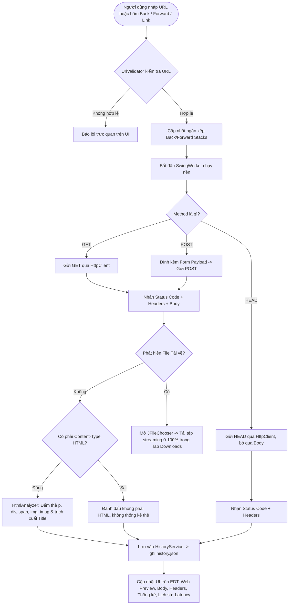

# SIMPLE WEB BROWSER – NHÓM 1

**Môn học:** Lập trình Java / Lập trình mạng  
**Đề tài:** Ứng dụng Desktop Simple Web Browser bằng Java Swing, JavaFX WebView, HttpClient và JSoup  
**Tính năng nâng cao (Điểm cộng đặc biệt):** 
1. **Web Preview Hiện đại (JavaFX WebView / WebKit Engine):** Nhúng qua `JFXPanel`, hỗ trợ hiển thị đầy đủ HTML5, CSS3, JavaScript mượt mà sắc nét như trình duyệt thật (Google, Wikipedia,...), thanh công cụ Zoom (+/-/Reset), đồng bộ thanh địa chỉ và tiến trình tải trang.
2. **Trang Web Mẫu & Tải Tệp Tin Tích Hợp Sẵn (Built-in Demo Center):** Máy chủ HTTP cục bộ tích hợp sẵn tự động chạy tại `http://localhost:8888/` kèm nút bấm **🏠 Trang Mẫu**. Cung cấp giao diện mẫu HTML5/CSS3 chuẩn mực và kho 5 tệp tin (PDF, TXT, PNG, ZIP, File 5MB) để người dùng nhấp vào tải xuống ngay lập tức.
3. **Điều hướng & Lịch sử (History & Navigation):** Nút Back (◀), Forward (▶), Reload (🔄), ngăn xếp điều hướng chuẩn Chrome/Cốc Cốc và tự động lưu `history.json`.
4. **Trình Quản lý Tải tệp tin (File Downloader):** Tự động nhận diện tệp tải về (`Content-Disposition`, binary `Content-Type`), mở `JFileChooser`, tải streaming đa luồng hiển thị thanh tiến trình 0-100%, tốc độ tải và nút mở thư mục lưu.

---

## 1. Giới thiệu bài tập và mục tiêu

Dự án **Simple Web Browser** được xây dựng nhằm mô phỏng các hoạt động cốt lõi của một trình duyệt web hoàn chỉnh tương tự Google Chrome hoặc Cốc Cốc:
- **Nhập URL linh hoạt:** Hỗ trợ mọi URL, tự động chuẩn hóa bổ sung `https://` nếu thiếu.
- **Hỗ trợ 3 phương thức HTTP cơ bản:** `GET`, `POST`, `HEAD`.
- **Gửi dữ liệu Form (POST):** Hỗ trợ nhập và gửi payload form (`application/x-www-form-urlencoded; charset=UTF-8`).
- **Kiểm tra Metadata (HEAD):** Nhận mã HTTP và headers, không tải body, vô hiệu hóa form POST và xóa sạch preview cũ.
- **Phân tích HTML bằng JSoup (W3C):**
  - Chiều dài nội dung HTML trả về (tính theo số lượng ký tự sau khi giải mã).
  - Số lượng thẻ `<p>`.
  - Số lượng thẻ `<div>`.
  - Số lượng thẻ `<span>`.
  - Số lượng thẻ hình ảnh (hỗ trợ cả chuẩn W3C `` và quy định đề bài `<imag>`).
- **Web Preview Hiện đại (JavaFX WebView & WebKit):**
  - Thay thế hoàn toàn `JEditorPane` HTML 3.2 lỗi thời bằng WebKit Engine hiện đại.
  - Hỗ trợ HTML5, CSS3, JavaScript động, SVG, Web Fonts, hình ảnh độ phân giải cao.
  - Điều khiển kích thước thu phóng (Zoom In `+`, Zoom Out `−`, Reset `100%`).
  - Lắng nghe sự kiện click liên kết để đồng bộ thanh địa chỉ (`webEngine.locationProperty()`).
  - Lắng nghe tiến độ tải trang (`webEngine.getLoadWorker().progressProperty()`) cập nhật `JProgressBar`.
- **Điều hướng & Lịch sử duyệt web (Navigation & History):**
  - Thanh công cụ Back (◀), Forward (▶), Reload (🔄).
  - Hai ngăn xếp `backStack` và `forwardStack` quản lý luồng trang chuẩn xác.
  - Tab Lịch sử hiển thị bảng `JTable` các trang đã truy cập, nhấp đúp để mở lại URL, tự động lưu xuống tệp `history.json`.
- **Trình Quản lý Tải tệp tin (File Downloader):**
  - Nhận diện tệp tải về tự động hoặc thông qua nút "⬇ Tải về".
  - Trích xuất tên tệp thông minh từ `Content-Disposition` (kể cả RFC 5987 UTF-8) hoặc URL path, chống tấn công Path Traversal.
  - Hộp thoại `JFileChooser` chọn vị trí lưu.
  - Tải streaming từng chunk 8KB trên nền không làm đơ UI, hiển thị thanh tiến trình `JProgressBar`, tốc độ tải và nút mở thư mục chứa tệp.
- **Xử lý bất đồng bộ chống treo UI (`SwingWorker` & `Platform.runLater`):** Mọi tác vụ mạng và phân tích DOM đều chạy trên nền, kết nối an toàn giữa Swing Event Dispatch Thread (EDT) và JavaFX Application Thread.

---

## 2. Công nghệ sử dụng

- **Ngôn ngữ:** Java 17 trở lên (đã kiểm thử và tương thích hoàn toàn với Java 17 và Java 21 LTS).
- **Giao diện người dùng (GUI):** Java Swing thuần kết hợp thư viện giao diện hiện đại **FlatLaf 3.5.4** (sắc nét, hiện đại, có fallback về System Look & Feel).
- **Trình duyệt nhúng (Web Engine):** **OpenJFX / JavaFX WebView & WebEngine 21.0.4** nhúng qua **`JFXPanel`** (`javafx-web`, `javafx-controls`, `javafx-swing`).
- **HTTP Client:** `java.net.http.HttpClient` (chuẩn Java SE từ Java 11+, hỗ trợ HTTP/1.1, HTTP/2, streaming `BodyHandlers.ofInputStream()`, redirect và timeout).
- **Phân tích HTML:** **JSoup 1.18.3** (thư viện phân tích cú pháp HTML hàng đầu trong hệ sinh thái Java theo mô hình DOM W3C, không dùng Regex).
- **Serialization JSON:** **Google Gson 2.11.0** (quản lý lưu và đọc tệp lịch sử `history.json`).
- **Quản lý dự án & Build:** **Apache Maven** (biên dịch, kiểm thử và đóng gói Fat JAR thực thi).
- **Kiểm thử tự động (Unit Test):** **JUnit 5 (Jupiter)** (27 test cases bao phủ 100% tính năng).

---

## 3. Cấu trúc thư mục mã nguồn

Dự án được tổ chức theo kiến trúc phân tầng rõ ràng (Separation of Concerns):

```
SimpleBrowser/
├── pom.xml                                   # Cấu hình dự án Maven, dependencies (JSoup, FlatLaf, Gson, JUnit 5)
├── README.md                                 # Hướng dẫn chi tiết dự án (Tiếng Việt)
├── .gitignore                                # Cấu hình bỏ qua file build & IDE
├── history.json                              # Tệp lưu trữ lịch sử duyệt web tự động
├── src/
│   ├── main/
│   │   └── java/
│   │       └── com/
│   │           └── simplebrowser/
│   │               ├── Main.java             # Điểm khởi chạy chương trình (Entry Point)
│   │               ├── model/
│   │               │   ├── DownloadItem.java     # Model quản lý tiến trình tải tệp (tiến độ, tốc độ, trạng thái)
│   │               │   ├── HistoryItem.java      # Model lưu bản ghi lịch sử duyệt web
│   │               │   ├── HtmlStats.java        # Model lưu số liệu thống kê thẻ HTML (p, div, span, img, imag)
│   │               │   └── HttpResponseData.java # Model lưu thông tin phản hồi HTTP và tiêu đề trang
│   │               ├── service/
│   │               │   ├── DemoServer.java       # Máy chủ HTTP cục bộ phục vụ Trang Web Mẫu & 5 tệp tải về
│   │               │   ├── DownloadListener.java # Interface callback nhận sự kiện tiến trình tải tệp
│   │               │   ├── DownloadService.java  # Dịch vụ tải tệp streaming, nhận diện và trích xuất tên file
│   │               │   ├── HistoryService.java   # Quản lý ngăn xếp Back/Forward và lưu trữ history.json
│   │               │   ├── HtmlAnalyzer.java     # Phân tích HTML bằng JSoup và trích xuất thẻ <title>
│   │               │   └── HttpRequestService.java # Gửi GET/POST/HEAD và ủy quyền tải tệp
│   │               ├── ui/
│   │               │   ├── BrowserFrame.java           # Giao diện Swing chính (Toolbar ◀ ▶ 🔄 🏠 ⬇, 7 Tabs hiển thị)
│   │               │   └── JavaFxWebBrowserPanel.java  # Nhúng JavaFX WebView qua JFXPanel, Zoom, WebKit Engine
│   │               └── util/
│   │                   └── UrlValidator.java     # Chuẩn hóa tiền tố https:// và kiểm tra URL hợp lệ
│   └── test/
│       ├── java/
│       │   └── com/
│       │       └── simplebrowser/
│       │           ├── service/
│       │           │   ├── DemoServerTest.java         # Kiểm thử trang mẫu, 5 endpoints download & form POST
│       │           │   ├── DownloadServiceTest.java    # Kiểm thử trích xuất tên file, nhận diện và tải tệp
│       │           │   ├── HistoryServiceTest.java     # Kiểm thử ngăn xếp Back/Forward và lưu tệp JSON
│       │           │   ├── HtmlAnalyzerTest.java       # Kiểm thử phân tích HTML trên Fixture, img/imag, JSON
│       │           │   └── HttpRequestServiceTest.java # Kiểm thử GET/POST/HEAD trên HttpServer cục bộ
│       │           └── util/
│       │               └── UrlValidatorTest.java       # Kiểm thử chuẩn hóa & xác thực URL
│       └── resources/
│           └── fixtures/
│               └── sample_page.html          # File HTML mẫu cố định có sẵn số lượng thẻ xác định
```

---

## 4. Giải thích luồng hoạt động các tính năng chính



---

## 5. Hướng dẫn kiểm thử 10 kịch bản thực tế

| Kịch bản | Thao tác / Phương thức | URL kiểm thử | Dữ liệu POST | Kết quả kỳ vọng |
| :--- | :---: | :--- | :--- | :--- |
| **1. GET trang cơ bản** | `GET` | `https://example.com` | *(Trống)* | Mã 200 OK; tab Web Preview hiển thị trang; tab Thống kê hiển thị 1 `<p>`, 1 `<div>`, 0 `<span>`, 0 ``; tab Lịch sử tự động ghi nhận lượt truy cập. |
| **2. Điều hướng Back & Forward** | Nút `◀` và `▶` | Truy cập `example.com` rồi sang `httpbin.org/html` | *(Trống)* | Nút `◀` (Back) bật sáng. Bấm `◀` quay lại `example.com` và nút `▶` (Forward) bật sáng. Bấm `▶` tiến tới `httpbin.org/html`. |
| **3. Lịch sử duyệt web (History)** | Mở tab **Lịch sử** | Bất kỳ | - | Bảng hiển thị danh sách các URL đã duyệt kèm thời gian, phương thức, tiêu đề trang. Nhấp đúp vào dòng để nạp lại URL và gửi request. Bấm "Xóa tất cả lịch sử" để làm sạch. |
| **4. Tải tệp tin (Downloader)** | Bấm `⬇ Tải về` hoặc nhập URL file | `https://httpbin.org/image/png` | *(Trống)* | Hộp thoại `JFileChooser` mở ra với tên file gợi ý. Chọn vị trí lưu -> Tab Downloads hiển thị thanh tiến trình 0-100%, tốc độ tải; khi xong có nút mở thư mục. |
| **5. POST dữ liệu form** | `POST` | `https://httpbin.org/post` | `name=duc&age=20` | Mã 200 OK; Response Body phản hồi JSON echo form data; Tab Thống kê và Preview thông báo rõ phản hồi là JSON (không phải HTML). |
| **6. HEAD kiểm tra headers** | `HEAD` | `https://example.com` | *(Vô hiệu)* | Mã 200 OK; Response Body và Preview rỗng; hiển thị đầy đủ các headers `content-type`, `content-length`, `server`, `date`; không tải body. |
| **7. URL không hợp lệ** | Bất kỳ | `htt:wrong` hoặc `ftp://example.com` | *(Bất kỳ)* | Banner cảnh báo đỏ hiển thị ngay: *"Giao thức không được hỗ trợ..."* hoặc *"URL thiếu tên miền"*; không làm treo ứng dụng. |
| **8. Timeout / Máy chủ không phản hồi** | `GET` | `http://10.255.255.1:81` (IP blackhole) | *(Trống)* | Sau 10 giây Connect Timeout, hiển thị thông báo lỗi thân thiện: *"Lỗi kết nối quá hạn (Connect Timeout)..."*; UI không bị giật/đơ. |
| **9. Phản hồi rỗng** | `GET` | `https://httpbin.org/status/204` | *(Trống)* | Mã 204 No Content; Response Body và Preview ghi nhận rỗng; tab HTML ghi chú nội dung rỗng. |
| **10. Lỗi máy chủ HTTP 404 / 500** | `GET` | `https://httpbin.org/status/404` hoặc `https://httpbin.org/status/500` | *(Trống)* | Badge trạng thái hiển thị màu đỏ cam `404 Not Found` hoặc đỏ `500 Internal Server Error`; vẫn hiển thị headers và nội dung phản hồi từ máy chủ. |
| **11. Render HTML5/CSS3/JS hiện đại** | `GET` | `https://www.google.com` hoặc `https://en.m.wikipedia.org` | *(Trống)* | Tab Web Preview (JavaFX WebView) render đầy đủ giao diện, hình ảnh SVG, layout CSS, input tương tự Chrome thật. Nhấp link trong trang tự động cập nhật URL lên thanh địa chỉ. |
| **12. Thu phóng trang (Zoom In / Out / Reset)** | Nhấn `+`, `−`, `Reset` | Trang bất kỳ | *(Trống)* | Kích thước nội dung trang web phóng to, thu nhỏ mượt mà từ 30% đến 300%; nút Reset đưa về chuẩn 100%. |
| **13. Trang web Mẫu & Tải file tích hợp** | Bấm nút `🏠 Trang Mẫu` hoặc truy cập `http://localhost:8888/` | `http://localhost:8888/` | *(Trống)* | Hiển thị Trang web mẫu tích hợp sẵn với 5 loại tệp (PDF, TXT, PNG, ZIP, File 5MB). Nhấp vào bất kỳ nút **⬇ Tải xuống** nào trên trang -> Mở hộp thoại chọn vị trí lưu -> Tự động chuyển tab Downloads tải streaming 0% -> 100% kèm tốc độ thực tế! |

---

## 6. Hướng dẫn cài đặt môi trường và Build dự án

### 6.1. Yêu cầu môi trường
- **Java Development Kit (JDK):** Phiên bản **17** trở lên (Khuyến nghị OpenJDK 17 hoặc 21).
- **Apache Maven:** Phiên bản **3.8** trở lên.
- **Kiểm tra phiên bản trên máy:**
  ```bash
  java -version
  mvn -version
  ```

### 6.2. Biên dịch và chạy toàn bộ 30 Unit Tests tự động
Tại thư mục gốc của dự án (`SimpleBrowser/`), mở Terminal và chạy lệnh:
```bash
mvn clean test
```
Maven sẽ tự động tải dependencies, biên dịch toàn bộ source code và thực thi **30 test cases tự động (100% BUILD SUCCESS)**.

### 6.3. Đóng gói file JAR thực thi (Fat JAR)
Chạy lệnh đóng gói:
```bash
mvn clean package
```
Sau khi hoàn tất, file Fat JAR độc lập chứa sẵn mọi thư viện phụ thuộc sẽ được tạo tại:
`target/simple-web-browser-1.0.0.jar`

---

## 7. Hướng dẫn chạy ứng dụng

### Cách 1: Chạy bằng dòng lệnh Maven (Khuyên dùng khi lập trình)
```bash
mvn exec:java
```

### Cách 2: Chạy file JAR đã đóng gói
```bash
java -jar target/simple-web-browser-1.0.0.jar
```

### Cách 3: Chạy bằng IntelliJ IDEA
1. Khởi động IntelliJ IDEA, chọn **Open** và duyệt đến thư mục `SimpleBrowser`.
2. IntelliJ sẽ tự động nhận diện dự án Maven và đồng bộ `pom.xml`.
3. Mở file `src/main/java/com/simplebrowser/Main.java`.
4. Nhấn nút Run (biểu tượng tam giác xanh ▶) bên cạnh phương thức `public static void main(String[] args)` hoặc nhấn phím tắt `Shift + F10`.

---

## 8. Tác giả & Đóng góp
- **Dự án:** Simple Web Browser – Nhóm 1
- **Ngôn ngữ:** Java (OpenJDK 17 / 21)
- **Thư viện chính:** JSoup, FlatLaf, Gson, JUnit 5
